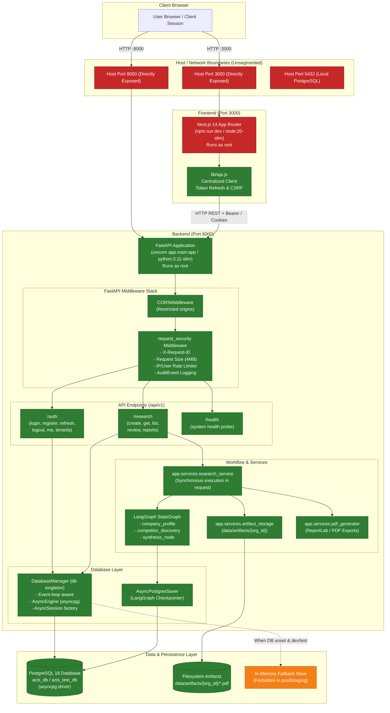

# ACIS Architecture Assessment: Current State

**Project:** AI Competitive Intelligence System (ACIS)  
**Repository:** `ai-competitive-intelligence`  
**Current Branch:** `phase-0-1-foundation`  
**Baseline Commit:** `f658533`  
**Assessment Date:** November 2026  
**Document Status:** Complete (Verified against codebase)

---

## 1. Executive Summary

This document captures the exact, verified technical architecture of the AI Competitive Intelligence System (ACIS) as of baseline commit `f658533` (acceptance of Phase 3.3). All findings are grounded directly in the repository code, test suites, and configuration files.

ACIS is currently structured as a full-stack, multi-tenant competitive intelligence platform:
- **Backend:** Python 3.11+ / FastAPI application with asynchronous SQLAlchemy 2.0, PostgreSQL 18 persistence, LangGraph agent workflows, Pydantic settings, and Alembic migrations.
- **Frontend:** Next.js 14 App Router application with React 18, Tailwind CSS, Lucide icons, and centralized API/authentication client.
- **Infrastructure:** Prototype Docker Compose and single-stage Dockerfiles designed for local development; no production-ready container images, no reverse proxy, and no automated CI/CD pipeline currently exist.

---

## 2. Current Architecture Diagram

---

## 3. Detailed Component Assessment

### 3.1 Backend Application (`backend/app`)

| Component | Current Implementation | Source Location | Security & Operational Assessment |
| :--- | :--- | :--- | :--- |
| **ASGI Engine** | `uvicorn app.main:app` running a single worker process | `infrastructure/docker/Dockerfile.backend` | **Development-only setup.** Lacks process management, worker concurrency tuning, and graceful signal handling under heavy load. |
| **Application Lifespan** | `@asynccontextmanager async def lifespan(app: FastAPI)` | `backend/app/main.py:38-52` | **Verified.** Configures structured logging on start, validates encryption keys in production, and properly awaits `db.dispose()` on shutdown. |
| **Configuration** | `pydantic-settings` with strict model validator | `backend/app/core/config.py` | **Hardened.** Rejects invalid `APP_ENV`, forbids `ACIS_ENABLE_MEMORY_FALLBACK` in staging/production, requires 32+ char JWT keys, enforces `AUTH_COOKIE_SECURE=True` in production, and forbids wildcard/localhost CORS in production. |
| **Security Middleware** | `request_security` HTTP middleware | `backend/app/main.py:97-225` | **Hardened.** Generates correlation UUID `X-Request-ID`, enforces 4MB max body streaming limits, executes rate limiting via `enforce_rate_limit(db)`, and records `AuditEvent` rows into PostgreSQL. |
| **Database Lifecycle** | `DatabaseManager` singleton (`db`) | `backend/app/core/database.py` | **Hardened (Commit f658533).** Fully loop-aware. Auto-detects closed or changed event loops, discards stale `AsyncEngine` instances, recreates clean asyncpg pools, and cleanly flushes connections on disposal. |
| **Workflow Execution** | `research_service.run_research` | `backend/app/services/research_service.py:213-280` | **Architectural bottleneck for production.** Runs synchronously inside the FastAPI HTTP request thread. In mock mode it completes in <1s, but with real LLMs and web scrapers, runs will take 30–90+ seconds, creating severe risk of HTTP proxy timeouts. |
| **Report Storage** | `ArtifactStorageService` | `backend/app/services/artifact_storage.py` | **Verified.** Implements strict tenant isolation (`data/artifacts/{organization_id}/`), regex validation (`^[a-zA-Z0-9_\-]+$`), and path-traversal prevention. |

### 3.2 Frontend Application (`frontend/`)

| Component | Current Implementation | Source Location | Security & Operational Assessment |
| :--- | :--- | :--- | :--- |
| **Framework & Engine** | Next.js 14.2.17 (App Router), React 18.3.1 | `frontend/package.json` | Modern React architecture with Server Components and Client Components. |
| **Build Mode** | `next dev -p 3000` inside Dockerfile | `infrastructure/docker/Dockerfile.frontend:14` | **Critical Defect for Production.** The existing Dockerfile runs the Next.js development server rather than `next build && next start`. |
| **Standalone Output** | Missing `output: 'standalone'` | `frontend/next.config.js` | Image size will be unnecessarily bloated (~1.2GB) because the full `node_modules` directory must be included rather than Next.js trace-minimized output (~180MB). |
| **API Client** | Centralized client with token refresh coordination | `frontend/lib/api.js` | **Hardened.** Manages Bearer tokens in memory, attaches `X-Organization-ID`, transmits HttpOnly refresh cookies with credentials, coordinates single-flight refreshes, and prevents CSRF. |
| **Origin & Proxying** | Next.js rewrite `/api/:path*` -> backend | `frontend/next.config.js:5-12` | During development, rewrites local requests to backend URL. In production, this should be handled directly by the reverse proxy. |

### 3.3 Database & Migrations

| Component | Current Implementation | Source Location | Security & Operational Assessment |
| :--- | :--- | :--- | :--- |
| **Database Server** | PostgreSQL 18 with `pgvector` extension | Local host / `ankane/pgvector` | Supports relational data, JSONB payloads, and vector embeddings. |
| **Migrations** | Alembic with 5 versions (`0001` through `0005`) | `backend/alembic/versions/` | Fully schema-versioned: initial tables, company profiles, competitors, identity/tenancy, and AES-256-GCM encrypted payload columns. |
| **Connection Pooling** | SQLAlchemy `create_async_engine` + `asyncpg` | `backend/app/core/database.py` | Default pool parameters (`pool_pre_ping=True`, `pool_size=10`, `max_overflow=20`). Lacks explicit server-level connection throttling or connection poolers (PgBouncer). |
| **Backup Automation** | None | Repository root | **Missing.** No automated backup script, backup schedule, or disaster recovery procedure exists. |

### 3.4 Existing Infrastructure & Containerization

| Component | Current Implementation | File Path | Evaluation |
| :--- | :--- | :--- | :--- |
| **Backend Dockerfile** | `python:3.11-slim`, single-stage | `infrastructure/docker/Dockerfile.backend` | **Non-Production.** Runs as `root`; no multi-stage build; no healthcheck directive; CMD runs basic `uvicorn` without worker tuning. |
| **Frontend Dockerfile** | `node:20-slim`, single-stage | `infrastructure/docker/Dockerfile.frontend` | **Non-Production.** Runs as `root`; executes `npm run dev`; installs all devDependencies; no multi-stage build; no standalone optimization. |
| **Docker Compose** | Development compose file | `docker-compose.yml` | **Non-Production.** Postgres service commented out; ports 3000 and 8000 exposed directly to host; no reverse proxy; no internal networks; no volume persistence for PostgreSQL; no healthchecks; no resource limits. |
| **CI/CD Workflows** | None | `.github/` | **Missing.** `.github/` contains only `copilot-instructions.md`. There are zero GitHub Actions workflows for automated testing, linting, security scanning, container building, or deployment. |

---

## 4. Current State Deficiencies & Gaps

1. **Absence of Ingress & Reverse Proxy:** No NGINX, Caddy, or Traefik service exists. Backend and frontend ports are directly mapped to the host, preventing TLS 1.3 termination, edge security headers, and single-domain routing.
2. **Container Security Deficiencies:** Both existing Dockerfiles run containers as `root` and rely on development commands (`npm run dev`) or single-process ASGI servers.
3. **Synchronous Long-Running Workflow Execution:** LangGraph research workflows run synchronously inside the incoming HTTP request. While acceptable for fast mock runs, this will break under real LLM latencies without an asynchronous execution model.
4. **No Automated Backup & DR:** No mechanism exists for automated PostgreSQL logical dumps (`pg_dump`), WAL archiving, offsite storage sync, or restore verification.
5. **No Centralized Observability:** Logs are emitted to standard output in text format without JSON structured schemas, trace context, or centralized metric collection.
6. **No Automated CI/CD:** All testing, building, and validation currently require manual CLI invocation on a developer machine.
