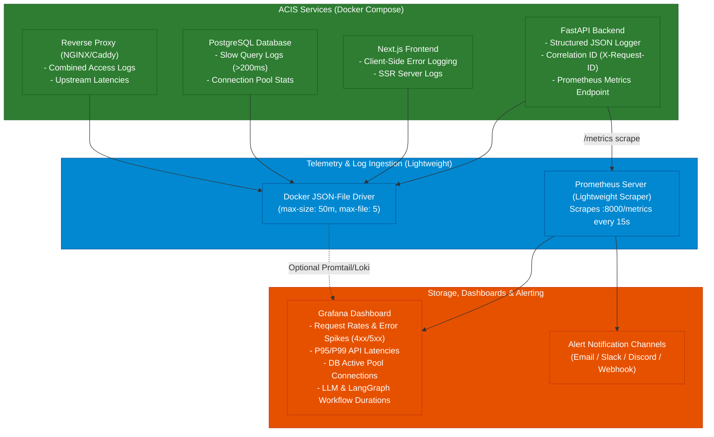

# ACIS Observability and Monitoring Strategy

**Project:** AI Competitive Intelligence System (ACIS)  
**Document:** Observability, Telemetry & Logging Architecture  
**Target Release:** Phase 4 Production Foundation  
**Philosophy:** Resource-Efficient, Actionable, Low-Overhead Observability

---

## 1. Observability Goals & Architecture

Enterprise observability frequently becomes bloated with heavy multi-gigabyte memory footprints (e.g. ELK stack or enterprise APM agents). For ACIS, the observability stack must remain lightweight (<500MB total RAM overhead), privacy-preserving, and immediately actionable for diagnosing application issues.



---

## 2. Structured JSON Application Logging

### 2.1 Backend Log Schema
In production, standard textual logging is replaced with structured JSON output emitted to `stdout`. Every log event carries unified contextual keys:

```json
{
  "timestamp": "2026-11-08T13:45:01.124Z",
  "level": "INFO",
  "logger": "app.services.research_service",
  "message": "LangGraph research workflow completed successfully",
  "request_id": "9f8b2c4e-1a3d-4e5f-8b2c-4e1a3d4e5f8b",
  "tenant_id": "org-acme-corp",
  "user_id": "usr-882194",
  "environment": "production",
  "duration_ms": 3412.5,
  "research_id": "res-772183",
  "status": "completed"
}
```

### 2.2 Sensitive Data Redaction
To prevent secret leaks and ensure privacy compliance:
1. **Credentials & Tokens:** Headers like `Authorization`, `Cookie`, and fields named `password`, `refresh_token`, `api_key`, or `secret` are intercepted by a logging sanitization filter and masked (`[REDACTED]`).
2. **Payload Protection:** Unencrypted research dossiers or proprietary corporate queries are not logged in full; only length and token counts are preserved.

---

## 3. End-to-End Request Correlation (`X-Request-ID`)

1. **Origin Generation:** The reverse proxy checks for an incoming `X-Request-ID`. If absent, it assigns a cryptographically unique UUIDv4.
2. **Backend Propagation:** FastAPI's `request_security` middleware extracts `X-Request-ID`, binds it to `request.state.request_id`, sets it in the thread-local logger context, and attaches it to `AuditEvent` rows.
3. **Downstream Logging:** All log entries across agents, repositories, and third-party API calls echo this `request_id`.
4. **Client Response:** The header `X-Request-ID: <id>` is returned on all responses, allowing users or support staff to cross-reference UI errors with exact server logs.

---

## 4. Health Checks: Liveness vs. Readiness Probes

The FastAPI application provides distinct probes to support automated container orchestration and self-healing:

### 4.1 Liveness Probe (`GET /api/v1/health/liveness` or `GET /api/v1/health`)
- **Purpose:** Verifies that the ASGI server is awake and accepting HTTP connections.
- **Behavior:** Returns HTTP 200 immediately without executing database queries:
  ```json
  {
    "status": "ok",
    "service": "ai-competitive-intelligence",
    "version": "0.1.0"
  }
  ```
- **Frequency:** Every 10 seconds. Failure initiates container restart.

### 4.2 Readiness Probe (`GET /api/v1/health/readiness`)
- **Purpose:** Verifies that all backend dependencies are functional before routing live user traffic to this instance.
- **Checks Executed:**
  1. **PostgreSQL Connectivity:** Executes `SELECT 1` via `db.session_factory()`.
  2. **Checkpointer Availability:** Validates `AsyncPostgresSaver` status.
  3. **Artifact Storage Writable:** Checks that `/app/data/artifacts` is mounted and writable.
  4. **Encryption Key Active:** Confirms valid active AES-256-GCM key loaded.
- **Behavior:** Returns HTTP 200 if all checks pass; HTTP 503 Service Unavailable if any core check fails.
- **Frequency:** Every 15 seconds. Failure removes container from proxy load balancer pool.

---

## 5. Key Performance Indicators & Telemetry Metrics

Using `prometheus-fastapi-instrumentator`, the backend exposes standard OpenMetrics at internal endpoint `/metrics` (accessible only from the Prometheus scraper container, not public):

| Metric Name | Type | Description | Alerting Threshold |
| :--- | :--- | :--- | :--- |
| `http_requests_total` | Counter | Total requests partitioned by method, handler, and status code. | Spike in 5xx errors (>2% over 5m). |
| `http_request_duration_seconds` | Histogram | Request latency distributions (p50, p90, p95, p99). | P95 latency > 2.0s for API routes. |
| `db_pool_active_connections` | Gauge | Number of connections checked out from the asyncpg pool. | >80% pool saturation for >2m. |
| `research_workflow_duration_seconds` | Histogram | End-to-end LangGraph execution time per research run. | >120s execution time warning. |
| `research_workflow_failures_total` | Counter | Total failed research executions partitioned by failure node. | >3 consecutive research failures. |
| `pdf_generation_duration_seconds` | Histogram | Time required to compile ReportLab PDF binary. | >5.0s per PDF compilation. |
| `rate_limit_exceeded_total` | Counter | Number of requests throttled by rate limiter. | Unusual spike indicating brute force / DDoS. |

---

## 6. Recommended Observability Stack Comparison

| Strategy | Memory Overhead | Operational Complexity | Cost | Verdict |
| :--- | :--- | :--- | :--- | :--- |
| **Tier 1: Docker Logs + Prometheus + Grafana (Self-Hosted)** | **~350 MB RAM** | Low. Standard Docker Compose services. | **$0** (Runs on host VM). | **Recommended for Initial Production Release.** Provides robust metrics, dashboards, and zero cloud lock-in. |
| **Tier 2: CloudWatch / GCP Cloud Monitoring** | **Near Zero RAM** | Moderate. Requires cloud agent and IAM credentials. | **~$5–$15 / month** (Log ingestion & metric alarms). | **Recommended if hosting on AWS EC2 or GCP Compute Engine.** |
| **Tier 3: Full OpenTelemetry Collector + Datadog / New Relic** | **>1.5 GB RAM** | High. Extensive instrumentation, agent tuning. | **$50–$200+ / month** (Host licenses & ingestion). | **Not recommended** for current stage; excessive cost and overhead. |
