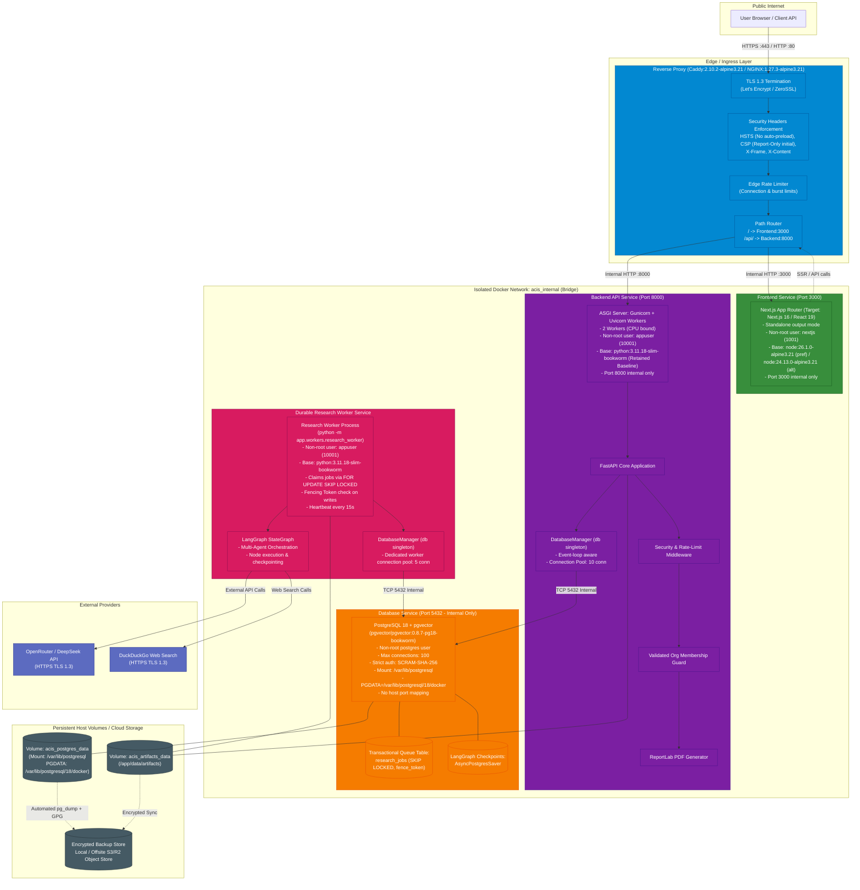

# ACIS Proposed Production Architecture

**Project:** AI Competitive Intelligence System (ACIS)  
**Document:** Proposed Production Architecture (Audited & Hardened)  
**Target Release:** Phase 4 Production Foundation  
**Architecture Style:** Modular Containerized Monolith with Durable Worker (Resource-Efficient & Secure)

---

## 1. Architectural Principles & Objectives

The proposed production architecture balances enterprise-grade security and reliability with operational simplicity and minimal infrastructure cost:
1. **Modular Monolith with Durable Worker:** Avoid premature decomposition into Kubernetes or complex microservices. A containerized modular monolith running FastAPI, Next.js, and a dedicated background research worker process delivers high throughput, zero broker overhead, and fits within a single cost-effective host.
2. **Durable Asynchronous LangGraph Execution:** Replace synchronous HTTP request execution with a PostgreSQL-backed transactional job queue (`research_jobs` with `SKIP LOCKED`) and a worker process. In-flight multi-agent workflows survive network drops, client disconnects, and worker container restarts by leveraging `AsyncPostgresSaver` checkpoint resumption and fencing tokens.
3. **At-Least-Once Execution with Idempotent Effects:** The architecture explicitly rejects unrealistic "exactly-once" claims in favor of robust **at-least-once execution with idempotent side effects**, protecting against duplicate LLM costs and stale state overwrites.
4. **Validated Organization Authorization:** A client-supplied `X-Organization-ID` never independently establishes tenant identity; tenant authorization is strictly derived from the authenticated user's validated organization memberships.
5. **Strict Network Segmentation & Zero Direct Public Exposure:** Only the reverse proxy (ports 80 and 443) is exposed to the public internet. The FastAPI backend, Next.js frontend, research worker, and PostgreSQL database communicate strictly across private, isolated Docker bridge networks.
6. **Defense-in-Depth Cookie & CSRF Security:** Enforce `SameSite=Strict`, `HttpOnly`, and `Secure` cookies alongside mandatory `X-CSRF-Token` validation, Origin validation, refresh token rotation, and replay revocation.
7. **Python 3.11 Baseline & Framework Modernization Gate:** Retain verified **`python:3.11.18-slim-bookworm`** (or `3.11.11-slim-bookworm` fallback) as the backend compatibility baseline. Next.js 14 is permitted only for temporary local infrastructure testing in Phase 4A; production release requires modernization to **Next.js 16** (or Next.js 15) on **Node.js 26/24 LTS**.

---

## 2. Proposed Production Architecture Diagram



---

## 3. Durable Worker Architecture, Fencing Tokens & Resumption

### 3.1 At-Least-Once Execution & Side-Effect Idempotency
Real-world distributed systems cannot guarantee "exactly-once" execution. Network blips, LLM timeouts, and container restarts require designing for **at-least-once execution with idempotent effects**:
- **Defensive Node Execution:** Before dispatching external LLM API calls or web searches, each LangGraph agent node checks if output data is already recorded in the current checkpoint or filesystem artifact.
- **Idempotency Keys:** Job submissions accept an optional or generated `idempotency_key` (hash of tenant ID, company name, and prompt parameters) preventing accidental duplicate research runs.

### 3.2 Monotonic Fencing Tokens (`fence_token`)
To protect against "zombie" workers (workers delayed by network partitions or garbage collection whose leases expired and were reassigned):
1. `research_jobs` maintains an integer `fence_token`. Every lease grant or reclamation increments this token.
2. The worker receives the current `fence_token` upon claiming the job.
3. Every checkpoint write, progress update, or completion statement conditionally checks:
   ```sql
   UPDATE research_jobs
   SET status = :status, error_details = :error_details, completed_at = NOW()
   WHERE id = :job_id AND fence_token = :worker_fence_token;
   ```
4. If 0 rows are updated, the worker immediately recognizes that its lease was revoked and its fence token superseded. It terminates execution cleanly without overwriting valid data.

### 3.3 LangGraph Checkpoint Resumption
Checkpoints are committed per node via `AsyncPostgresSaver` under `thread_id = f"{org_id}:{research_id}"`. When a reclaimed job is picked up by a worker, LangGraph initializes from the latest persisted checkpoint, avoiding re-running previously completed agent steps.

---

## 4. End-to-End Sequence & Data Flow

```mermaid
sequenceDiagram
    autonumber
    actor User as Client Browser
    participant Proxy as Reverse Proxy (TLS 1.3)
    participant API as FastAPI Backend (:8000)
    participant PG as PostgreSQL 18 DB (:5432)
    participant Worker as Research Worker
    participant LLM as OpenRouter / DeepSeek

    %% 1. Submission Flow
    Note over User,PG: 1. Asynchronous Job Enqueue with Validated Tenant Scoping
    User->>Proxy: POST /api/v1/research (Bearer JWT, X-Organization-ID)
    Proxy->>API: Forward Request
    API->>API: Validate JWT; Validate user is confirmed member of org_id
    API->>PG: BEGIN; Insert research_record; Insert research_jobs (pending, fence_token=1); COMMIT;
    API-->>Proxy: HTTP 202 Accepted { research_id, job_id, status: 'pending' }
    Proxy-->>User: 202 Accepted

    %% 2. Background Processing
    Note over Worker,LLM: 2. Worker Processing with Fencing & Checkpointing
    Worker->>PG: SELECT ... FROM research_jobs WHERE status='pending' FOR UPDATE SKIP LOCKED
    PG-->>Worker: Claimed Job (status='running', fence_token=1, worker_id=W1)
    
    par Heartbeat Loop
        loop Every 15s
            Worker->>PG: UPDATE research_jobs SET lease_expires_at = NOW()+30s WHERE id=job_id AND fence_token=1
        end
    and Workflow Execution
        Worker->>LLM: Node 1: Company Profile Agent
        LLM-->>Worker: Profile Output
        Worker->>PG: Checkpoint State (AsyncPostgresSaver)
        Worker->>LLM: Node 2: Competitor Discovery Agent
        LLM-->>Worker: Competitors Output
        Worker->>PG: Checkpoint State (AsyncPostgresSaver)
        Worker->>PG: UPDATE research_jobs SET status='completed' WHERE id=job_id AND fence_token=1
        Worker->>PG: UPDATE research_records SET status='completed' WHERE id=research_id
    end

    %% 3. Status Polling
    Note over User,API: 3. Frontend Polling & Result Retrieval
    loop Every 3 Seconds
        User->>Proxy: GET /api/v1/research/{id}
        Proxy->>API: Forward GET (Validated Tenant)
        API->>PG: SELECT * FROM research_records WHERE id=:id AND organization_id=:org_id
        PG-->>API: Status (pending -> running -> completed)
        API-->>User: HTTP 200 { status: 'completed', data: {...} }
    end
```

---

## 5. Comprehensive Reliability & Failure Matrix

| Failure Scenario | Immediate System Impact | Recovery Mechanism & Invariant Preserved |
| :--- | :--- | :--- |
| **API Failure / Crash** | HTTP request fails during job submission. | Transaction rolls back atomically; no orphan `research_records` or `research_jobs` created. Client safely retries with idempotency key. |
| **Worker Process Crash (SIGKILL / OOM)** | In-flight research stops mid-workflow; lease expires. | Supervisor routine detects `lease_expires_at < NOW()`, increments `fence_token`, and returns job to `pending`. Next worker resumes from last LangGraph checkpoint. |
| **Host Reboot / Power Outage** | Containers shut down abruptly. | Docker restarts containers (`restart: unless-stopped`). Unfinished jobs have expired leases and are reclaimed automatically on startup. |
| **Database Network Interruption** | Worker cannot write heartbeat or checkpoint. | Worker detects database error; pauses processing. If lease expires, supervisor reclaims job; worker aborts upon reconnection due to mismatched `fence_token`. |
| **LLM Provider Timeout (OpenRouter)** | Agent node request hangs or raises timeout. | Request retries with exponential backoff up to node-level timeout; on terminal failure, job marked `failed` with structured JSON error details. |
| **Duplicate Job Submission** | User double-clicks submit in browser. | Unique constraint on `(organization_id, idempotency_key)` catches duplicate, returning existing `research_id` without launching a second workflow. |
| **Lease Expiration / Zombie Worker** | Slow worker delayed by GC recovers after lease expired. | Zombie worker's subsequent write fails (`fence_token` mismatched, 0 rows updated); worker immediately halts execution and commits no stale state. |
| **Job Cancellation by User** | User clicks "Cancel Research" in UI. | API updates `research_jobs.status = 'cancelled'`. Worker queries status between LangGraph nodes, detects cancellation, logs `AuditEvent`, and aborts cleanly. |

---

## 6. Security & Isolation Invariants

1. **Defense-in-Depth Cookie Security:** Refresh cookies strictly enforce `HttpOnly: true`, `Secure: true`, and `SameSite: Strict`. CSRF protection is enforced via `X-CSRF-Token` headers, Origin validation, refresh rotation, and replay session revocation.
2. **Derived Organization Authorization:** Client-supplied `X-Organization-ID` is verified against authenticated user memberships in PostgreSQL; cross-tenant queries return HTTP 404 to prevent resource enumeration.
3. **Container Non-Root:** All containers execute under unprivileged user IDs (`10001` backend/worker, `1001` frontend).
4. **PostgreSQL Network Isolation & Volume Conventions:** PostgreSQL 18 (`pgvector/pgvector:0.8.7-pg18-bookworm`) is internal-only, enforcing named volume `acis_postgres_data` mounted at `/var/lib/postgresql` with `PGDATA=/var/lib/postgresql/18/docker`.
