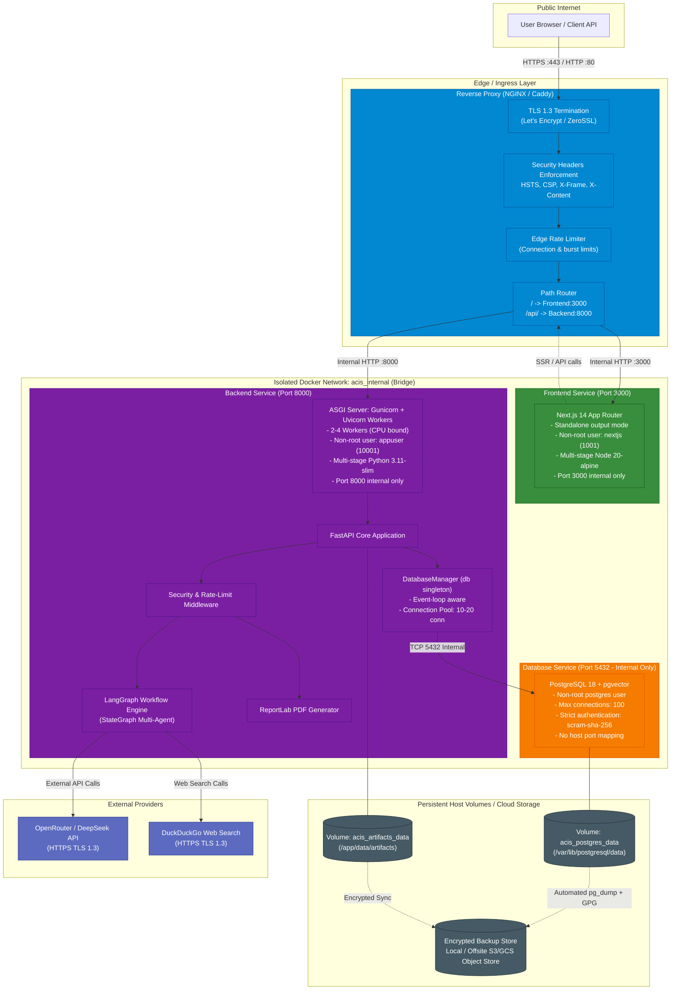
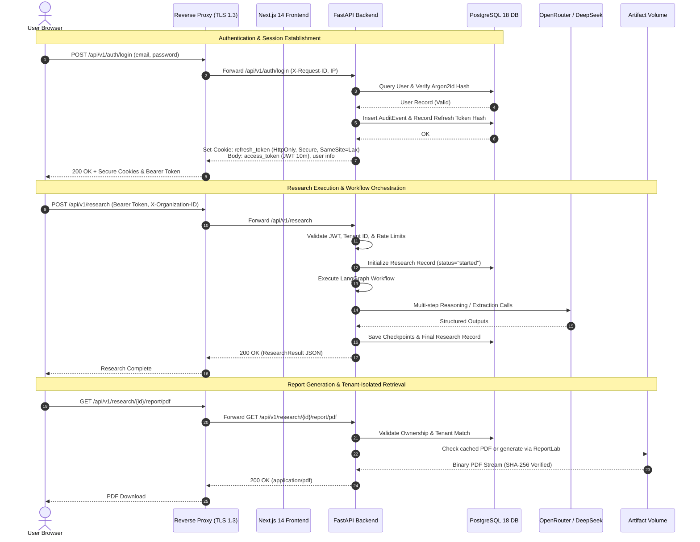

# ACIS Proposed Production Architecture

**Project:** AI Competitive Intelligence System (ACIS)  
**Document:** Proposed Production Architecture  
**Target Release:** Phase 4 Production Foundation  
**Architecture Style:** Modular Containerized Monolith (Resource-Efficient & Secure)

---

## 1. Architectural Principles & Objectives

The proposed production architecture balances enterprise-grade security and reliability with operational simplicity and minimal infrastructure cost:
1. **Modular Monolith over Microservices:** Avoid premature decomposition into Kubernetes or distributed microservices. A containerized modular monolith running FastAPI and Next.js delivers sub-millisecond inter-process communication, minimal operational overhead, and fits within a single cost-effective host (or managed container platform).
2. **Strict Network Segmentation & Zero Direct Public Exposure:** Only the reverse proxy (ports 80 and 443) is exposed to the public internet. The FastAPI backend, Next.js frontend, and PostgreSQL database communicate strictly across private, isolated Docker bridge networks.
3. **Least Privilege & Immutable Containers:** Containers run as non-root unprivileged service accounts (`nextjs` UID 1001, `appuser` UID 10001), have read-only root filesystems where practical, and mount dedicated persistent volumes for artifacts and data.
4. **Single-Domain Ingress & Cohesive Cookie Security:** Ingress routes both static UI pages (`/`) and API requests (`/api/v1`) through a unified reverse proxy domain (e.g. `https://acis.example.com`), allowing `SameSite=Strict` or `SameSite=Lax` HttpOnly refresh cookies without cross-site third-party cookie restrictions.
5. **Decoupled Workflow Scalability:** Provide an evolutionary path for LangGraph research execution: begin with synchronous execution for mock/fast workloads, with a seamless transition to asynchronous execution (FastAPI `BackgroundTasks` or Redis/ARQ task queue) for multi-minute live LLM research jobs.

---

## 2. Proposed Production Architecture Diagram

---

## 3. Component Architecture & Responsibilities

### 3.1 Reverse Proxy & TLS Ingress (NGINX / Caddy)
- **Primary Function:** Edge termination, traffic routing, and transport security.
- **Responsibilities:**
  - Terminates TLS 1.3 / 1.2 with automated certificate renewal (Let's Encrypt / ACME).
  - Routes traffic based on URI path prefix:
    - `/api/*` and `/docs` -> FastAPI Backend service (`http://backend:8000`).
    - `/*` -> Next.js Frontend service (`http://frontend:3000`).
  - Sets edge security headers: `Strict-Transport-Security`, `X-Content-Type-Options: nosniff`, `X-Frame-Options: DENY`, `Referrer-Policy: strict-origin-when-cross-origin`, and `Content-Security-Policy`.
  - Enforces request body size limits (matches backend 4MB limit) at the proxy layer to prevent slowloris and buffer exhaustion.
  - Passes trusted proxy headers (`X-Forwarded-For`, `X-Forwarded-Proto`, `X-Forwarded-Host`, `X-Request-ID`) to backend services.

### 3.2 Frontend Application Service (Next.js 14)
- **Primary Function:** User interface rendering, client-side session hydration, and visual reporting.
- **Configuration & Runtime:**
  - Multi-stage Docker image built on `node:20-alpine`.
  - Next.js `output: 'standalone'` builds minimal ~180MB container containing only pruned dependencies and precompiled `.next/standalone` assets.
  - Runs under unprivileged user `nextjs` (UID 1001, GID 1001).
  - Listens only on internal port `3000` (no public host port binding).
- **Communication:**
  - Browser executes API calls directly to `/api/v1/*` via the reverse proxy.
  - Server-side rendering (SSR) fetches reach the backend via internal Docker DNS (`http://backend:8000/api/v1/*`).

### 3.3 Backend API Service (FastAPI)
- **Primary Function:** Authentication, RBAC, tenant enforcement, API routing, LangGraph agent orchestration, PDF generation, and audit logging.
- **Configuration & Runtime:**
  - Multi-stage Docker image based on `python:3.11-slim` or `python:3.12-slim`.
  - Production ASGI execution via `gunicorn` with `uvicorn.workers.UvicornWorker` (2–4 workers based on available CPU cores).
  - Runs under unprivileged system user `appuser` (UID 10001, GID 10001).
  - Listens only on internal port `8000`.
- **Database Connection Pool:**
  - SQLAlchemy `create_async_engine` configured with `pool_size=10`, `max_overflow=10`, `pool_timeout=30`, and `pool_pre_ping=True`.
  - Total connections per container instance capped at 20 (allowing headroom within PostgreSQL's default 100-connection limit).

### 3.4 PostgreSQL 18 Database Service
- **Primary Function:** Relational data storage, tenant identity, research results, vector embeddings (`pgvector`), and LangGraph checkpoint states (`AsyncPostgresSaver`).
- **Configuration & Security:**
  - Official PostgreSQL 18 image with `pgvector` pre-installed (`ankane/pgvector:latest` or official Postgres 18 with compiled extension).
  - Accessible **only** within the internal Docker bridge network (`acis_internal`). Host port `5432` is strictly unmapped in production.
  - Authentication enforced via `scram-sha-256`.
  - Persistent storage mounted on host volume `acis_postgres_data`.
  - Database encoding: `UTF8`, collation `en_US.UTF-8`.

### 3.5 Artifact & Report Storage Service
- **Primary Function:** Tenant-isolated storage for binary PDF artifacts, Markdown documents, and export caches.
- **Security & Path Validation:**
  - Mounted on persistent volume `acis_artifacts_data` at `/app/data/artifacts`.
  - Volume permissions restricted to `appuser:appgroup` (`chmod 750`).
  - Strict path traversal validation enforced by `ArtifactStorageService`: tenant directory validation (`^[a-zA-Z0-9_\-]+$`) and containment checks via `Path.is_relative_to()`.

---

## 4. End-to-End Interaction & Data Flow

---

## 5. Workflow Execution Strategy: Synchronous vs. Asynchronous

### Current State
In the current codebase, `research_service.run_research()` is invoked synchronously within the FastAPI route handler. With mock search agents and deterministic mock nodes, this finishes in ~500ms.

### Production Reality & Transition Plan
When live LLM APIs (OpenRouter/DeepSeek) and web searches are connected:
1. **Latency:** A complete research run (company profiling, candidate competitor discovery, evidence validation, and strategic synthesis) requires 4–8 LLM round-trips and multiple web searches, taking **30 to 120 seconds**.
2. **Proxy Timeout Risk:** Standard reverse proxies and client HTTP libraries time out at 30–60 seconds unless specifically configured with keep-alives.
3. **Worker Thread Exhaustion:** Long-running requests hold ASGI worker threads open, degrading system throughput.

### Recommended Architectural Transition (Two-Stage):

#### Stage 1 (Initial Release — FastAPI BackgroundTasks):
- Route `POST /api/v1/research` immediately creates a database record with status `"pending"`, registers a FastAPI `BackgroundTask` to run the LangGraph pipeline asynchronously, and returns HTTP 202 Accepted with the `research_id`.
- The frontend polls `GET /api/v1/research/{id}` (which is already implemented and tested) until status becomes `"completed"` or `"failed"`.
- **Zero new infrastructure dependencies** (no Redis or Celery needed).

#### Stage 2 (Scaling Release — Dedicated Task Queue):
- When concurrent research workloads increase, introduce a lightweight asynchronous task queue (`ARQ` backed by Redis, or PostgreSQL-native `pg-boss` / `procrastinate`).
- Decouples API workers from AI execution workers completely, allowing independent scaling of API and compute nodes.
