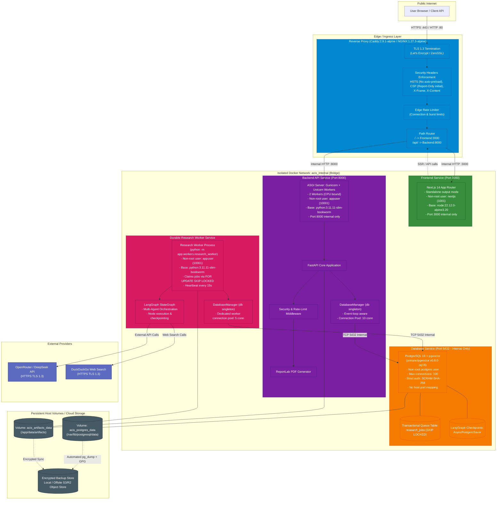

# ACIS Proposed Production Architecture

**Project:** AI Competitive Intelligence System (ACIS)  
**Document:** Proposed Production Architecture  
**Target Release:** Phase 4 Production Foundation  
**Architecture Style:** Modular Containerized Monolith with Durable Worker (Resource-Efficient & Secure)

---

## 1. Architectural Principles & Objectives

The proposed production architecture balances enterprise-grade security and reliability with operational simplicity and minimal infrastructure cost:
1. **Modular Monolith with Durable Execution:** Avoid premature decomposition into Kubernetes or complex microservices. A containerized modular monolith running FastAPI, Next.js, and a dedicated background research worker process delivers high throughput, zero broker overhead, and fits within a single cost-effective host.
2. **Durable Asynchronous LangGraph Execution:** Replace synchronous HTTP request execution with a PostgreSQL-backed transactional job queue (`research_jobs` with `SKIP LOCKED`) and a worker process. In-flight multi-agent workflows survive network drops, client disconnects, and worker container restarts by leveraging `AsyncPostgresSaver` checkpoint resumption.
3. **Strict Network Segmentation & Zero Direct Public Exposure:** Only the reverse proxy (ports 80 and 443) is exposed to the public internet. The FastAPI backend, Next.js frontend, research worker, and PostgreSQL database communicate strictly across private, isolated Docker bridge networks.
4. **Least Privilege & Immutable Containers:** Containers run as non-root unprivileged service accounts (`nextjs` UID 1001, `appuser` UID 10001), have pinned base image digests (`node:22.12.0-alpine3.20`, `python:3.11.11-slim-bookworm`, `ankane/pgvector:v0.8.0-pg18`), and mount dedicated persistent volumes for artifacts and data.
5. **Single-Origin Ingress & Strict Cookie Security:** Ingress routes both static UI pages (`/`) and API requests (`/api/v1`) through a unified reverse proxy domain (e.g. `https://acis.example.com`), allowing `SameSite=Strict` HttpOnly, Secure refresh cookies without cross-site third-party cookie restrictions.

---

## 2. Proposed Production Architecture Diagram



---

## 3. Durable Asynchronous Workflow Execution Model

### 3.1 Why Synchronous and In-Memory Execution Fail in Production
- **Synchronous Execution:** A real LLM research run takes 30–120+ seconds. Synchronous requests hit 60s proxy timeouts and monopolize ASGI worker processes.
- **FastAPI BackgroundTasks Alone:** Executes in ephemeral process memory. If the backend restarts (deployment, scaling, OOM, host maintenance), in-flight and queued jobs are permanently destroyed without recovery.

### 3.2 The PostgreSQL Transactional Queue Pattern (`SKIP LOCKED`)
ACIS utilizes PostgreSQL 18's native concurrency primitives, eliminating external message broker dependencies (Redis/RabbitMQ):
1. **Request Creation:** `POST /api/v1/research` inserts a `research_records` row and an associated `research_jobs` row (`status = 'pending'`) inside a single atomic ACID transaction, immediately returning HTTP 202 Accepted with `research_id`.
2. **Worker Claiming:** Dedicated worker processes run an asynchronous poll loop:
   ```sql
   WITH next_job AS (
     SELECT id FROM research_jobs
     WHERE status = 'pending' AND scheduled_at <= NOW()
     ORDER BY created_at ASC
     LIMIT 1
     FOR UPDATE SKIP LOCKED
   )
   UPDATE research_jobs
   SET status = 'running',
       worker_id = :worker_id,
       attempt_count = attempt_count + 1,
       started_at = NOW(),
       heartbeat_at = NOW()
   FROM next_job
   WHERE research_jobs.id = next_job.id
   RETURNING research_jobs.*;
   ```
3. **Heartbeats & Crash Recovery:** The worker emits a heartbeat every 15 seconds. If a worker container crashes, a supervisor query reclaims stale jobs (`heartbeat_at < NOW() - INTERVAL '90 seconds'`) for retry.
4. **LangGraph State Resumption:** Retried jobs resume from their last successful node using LangGraph's `AsyncPostgresSaver` checkpointer rather than restarting from scratch.
5. **Frontend Polling:** The frontend polls `GET /api/v1/research/{id}` (every 2–3 seconds) to display progress indicators and render results once `status == 'completed'`.

---

## 4. End-to-End Sequence & Data Flow

```mermaid
sequenceDiagram
    autonumber
    actor User as User Browser
    participant Proxy as Reverse Proxy (TLS 1.3)
    participant API as FastAPI Backend
    participant PG as PostgreSQL 18 DB
    participant Worker as Research Worker
    participant LLM as OpenRouter / DeepSeek
    participant Disk as Artifact Volume

    %% Job Submission Flow
    Note over User,PG: 1. Asynchronous Job Enqueue
    User->>Proxy: POST /api/v1/research (Bearer Token, X-Organization-ID)
    Proxy->>API: Forward Request
    API->>API: Validate Token, Rate Limits & Tenant Match
    API->>PG: BEGIN; Insert research_record; Insert research_job (pending); COMMIT;
    API-->>Proxy: HTTP 202 Accepted { research_id, status: "pending" }
    Proxy-->>User: 202 Accepted

    %% Background Execution Flow
    Note over Worker,Disk: 2. Worker Processing & Checkpointing
    Worker->>PG: Poll (SELECT ... FOR UPDATE SKIP LOCKED)
    PG-->>Worker: Claimed Job (status="running")
    Worker->>PG: Heartbeat Loop (every 15s)
    Worker->>LLM: Node 1: Company Profile Agent
    LLM-->>Worker: Profile Data
    Worker->>PG: Save LangGraph Checkpoint (Node 1)
    Worker->>LLM: Node 2: Competitor Discovery Agent
    LLM-->>Worker: Competitors Data
    Worker->>PG: Save LangGraph Checkpoint (Node 2)
    Worker->>Disk: Generate & Save PDF Artifact
    Worker->>PG: UPDATE research_record (completed); UPDATE research_job (completed);

    %% Frontend Polling
    Note over User,API: 3. Status Polling & Result Retrieval
    loop Every 3 Seconds
        User->>Proxy: GET /api/v1/research/{id}
        Proxy->>API: Forward GET
        API->>PG: Query research_record
        PG-->>API: Record State (pending -> running -> completed)
        API-->>User: HTTP 200 { status: "completed", data: {...} }
    end
```

---

## 5. Security & Isolation Invariants

1. **Cookie Policy:** Refresh tokens are strictly delivered with `SameSite=Strict`, `HttpOnly`, and `Secure` attributes over HTTPS.
2. **Tenant Scoping:** All job polling, research processing, and report generation query strictly with `WHERE organization_id = :org_id`.
3. **Container Non-Root:** All containers execute under unprivileged user IDs (`10001` backend/worker, `1001` frontend).
4. **Network Isolation:** PostgreSQL is only accessible across the internal Docker bridge network (`acis_internal`). Public port mapping is forbidden.
