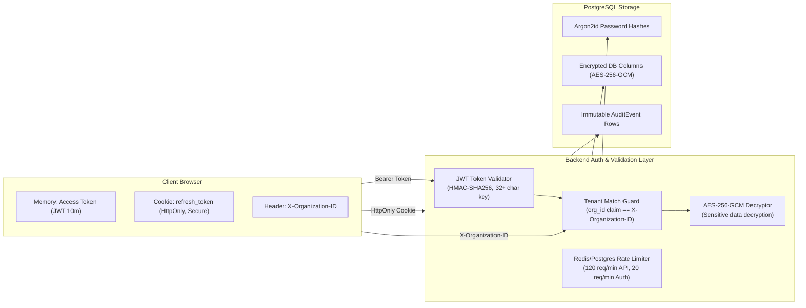

# ACIS Security and Network Design

**Project:** AI Competitive Intelligence System (ACIS)  
**Document:** Security & Network Architecture  
**Target Release:** Phase 4 Production Foundation  
**Classification:** Security Architecture Specification

---

## 1. Network Segmentation & Ingress Architecture

The production deployment enforces defense-in-depth across the physical host, network layer, transport layer, and application runtime.

```mermaid
flowchart TD
    subgraph PublicZone ["Public Network (Untrusted)"]
        InternetTraffic["Incoming Internet Traffic\n(IPv4 / IPv6)"]
    end

    subgraph HostBoundary ["Production Host Boundary (Firewall / UFW)"]
        Firewall["Host Firewall (UFW / iptables)\nAllow Inbound: 80, 443, 22 (SSH keys only)\nDrop All Other Inbound Ports"]
        
        subgraph IngressBridge ["Docker Bridge Network: acis_ingress"]
            ProxyContainer["Reverse Proxy (NGINX / Caddy)\n- Exposed: 0.0.0.0:80, 0.0.0.0:443\n- TLS 1.3 Termination\n- Drops Host Headers\n- Strips internal spoofed headers"]
        end

        subgraph InternalBridge ["Docker Bridge Network: acis_internal (Isolated)"]
            FrontendContainer["Next.js Frontend Container\n- Internal Port: 3000\n- NO Host Port Mapping"]
            BackendContainer["FastAPI Backend Container\n- Internal Port: 8000\n- NO Host Port Mapping\n- Trusted Proxy: Only Reverse Proxy IP"]
            PostgresContainer["PostgreSQL 18 Database\n- Internal Port: 5432\n- NO Host Port Mapping\n- Isolated from public internet"]
        end
    end

    InternetTraffic -->|TCP 80 / 443| Firewall --> ProxyContainer
    ProxyContainer -->|HTTP :3000 (Internal)| FrontendContainer
    ProxyContainer -->|HTTP :8000 (Internal)| BackendContainer
    BackendContainer -->|TCP :5432 (Internal)| PostgresContainer
    FrontendContainer -.->|SSR / Internal API| ProxyContainer

    classDef public fill:#d32f2f,stroke:#b71c1c,color:#fff;
    classDef firewall fill:#e65100,stroke:#bf360c,color:#fff;
    classDef proxy fill:#0288d1,stroke:#01579b,color:#fff;
    classDef internal fill:#388e3c,stroke:#1b5e20,color:#fff;

    class PublicZone,InternetTraffic public;
    class HostBoundary,Firewall firewall;
    class IngressBridge,ProxyContainer proxy;
    class InternalBridge,FrontendContainer,BackendContainer,PostgresContainer internal;
```

### 1.1 Ingress & Port Exposure Rules
- **Publicly Accessible Ports:**
  - `443/tcp`: HTTPS (TLS 1.3 / 1.2).
  - `80/tcp`: HTTP (Permanent 301 redirect to HTTPS; Let's Encrypt ACME challenges).
  - `22/tcp` (or non-standard port): SSH (Key-based authentication only, password auth disabled, fail2ban active).
- **Prohibited Port Mappings:**
  - `5432/tcp` (PostgreSQL): **Strictly internal.** Binding to `0.0.0.0:5432` or any public interface is blocked by container configuration and host firewall.
  - `8000/tcp` (FastAPI backend): Internal only. Public access is mediated entirely through the reverse proxy.
  - `3000/tcp` (Next.js frontend): Internal only.

---

## 2. Reverse Proxy & Transport Layer Security (TLS)

### 2.1 TLS Configuration
- **Protocols:** TLS 1.3 (primary) and TLS 1.2 (for backward compatibility). SSLv2, SSLv3, TLS 1.0, and TLS 1.1 are explicitly disabled.
- **Cipher Suites:** Modern PFS (Perfect Forward Secrecy) ciphers:
  - `TLS_AES_256_GCM_SHA384`
  - `TLS_CHACHA20_POLY1305_SHA256`
  - `TLS_AES_128_GCM_SHA256`
  - `ECDHE-ECDSA-AES256-GCM-SHA384`
  - `ECDHE-RSA-AES256-GCM-SHA384`
- **Certificate Lifecycle:** Automated issuance and renewal using Let's Encrypt ACME via Caddy or NGINX + Certbot with automated 60-day renewal hooks.

### 2.2 HTTP Security Headers
The reverse proxy injects mandatory security headers on every response:

```http
Strict-Transport-Security: max-age=63072000; includeSubDomains; preload
X-Content-Type-Options: nosniff
X-Frame-Options: DENY
Referrer-Policy: strict-origin-when-cross-origin
Permissions-Policy: camera=(), microphone=(), geolocation=(), payment=()
Content-Security-Policy: default-src 'self'; script-src 'self' 'unsafe-inline'; style-src 'self' 'unsafe-inline'; img-src 'self' data: https:; font-src 'self'; connect-src 'self'; frame-ancestors 'none';
```

### 2.3 Trusted Proxy & Anti-Spoofing Configuration
To prevent spoofed IP injection and ensure accurate audit logging and rate limiting:
1. **Header Stripping:** The reverse proxy sanitizes and rewrites all incoming `X-Forwarded-*` headers before forwarding requests.
2. **FastAPI Trusted Proxy Settings:**
   - In production, FastAPI/Uvicorn is executed with `--proxy-headers` and `--forwarded-allow-ips=172.16.0.0/12,192.168.0.0/16,10.0.0.0/8` (restricting trusted proxy signals to internal Docker bridge subnets).
3. **Correlation ID Propagation:** The reverse proxy generates an `X-Request-ID` (UUIDv4) if absent, which FastAPI binds to `request.state.request_id` and attaches to all outgoing responses and audit logs.

---

## 3. Application Security & Authentication Hardening



### 3.1 Authentication & Session Controls
- **Password Storage:** Verified Argon2id with memory cost 65536 KiB, time cost 3 iterations, and 4 lanes. Raw passwords are never logged, stored, or cached.
- **Short-Lived Access Tokens:** Issued as signed JWTs valid for **10 minutes**, carrying `sub` (user_id), `org_id` (organization_id), `role`, and expiration timestamps.
- **Refresh Token Rotation & Revocation:** Refresh tokens are 30-day cryptographically random 64-character tokens stored only in HTTP cookies with `HttpOnly`, `Secure`, and `SameSite=Lax` attributes. Each refresh issuance invalidates the prior refresh token.
- **Email Lookup Protection:** Blind index hashing using HMAC-SHA256 (`AUTH_EMAIL_LOOKUP_KEY`) allows lookups without plaintext indexing.

### 3.2 Tenant Isolation & Multi-Tenancy Defense
- **Header & Token Matching:** Incoming requests to `/api/v1/research/*` must present both a valid JWT and an `X-Organization-ID` header. The backend strictly validates that the caller is a member of the requested organization; mismatches result in immediate HTTP 403 Forbidden.
- **Row-Level Query Scoping:** All SQLAlchemy repositories (`ResearchRepository`, `TenantRepository`, etc.) enforce mandatory `WHERE organization_id = :org_id` filters on all `SELECT`, `UPDATE`, and `DELETE` queries.
- **Artifact Path Traversal Defense:** `ArtifactStorageService` rejects any tenant identifier or artifact filename that violates `^[a-zA-Z0-9_\-]+$`, and verifies that resolved paths reside inside `/app/data/artifacts/{org_id}/` via `Path.is_relative_to()`.

### 3.3 Data Encryption at Rest
- **Sensitive Payload Encryption:** Database columns storing research intelligence, competitor dossiers, evidence notes, and LLM raw outputs are encrypted using AES-256-GCM with unique 96-bit initialization vectors (IVs) per row via `app.security.crypto`.
- **Key Rotation Support:** Multiple keys can be registered in `DATA_ENCRYPTION_KEYS` JSON (`{"v1": "...", "v2": "..."}`). New writes use `DATA_ENCRYPTION_ACTIVE_KEY_ID`, while reads dynamically decrypt legacy versions.

---

## 4. Production Secrets Management Strategy

### 4.1 Comparative Evaluation of Secrets Management Approaches

| Strategy | Security Posture | Operational Complexity | Cost | Suitability for Initial Production |
| :--- | :--- | :--- | :--- | :--- |
| **Option 1: Environment File (`.env`) with Strict File Permissions** | **Moderate.** Stored on host disk; readable by host root/app user. If host is compromised, secrets are exposed. | **Lowest.** Standard Docker Compose `env_file` or `environment`. Familiar, no extra services. | **Free.** | **Recommended for Initial Production Release**, provided file permissions are `chmod 0600` and host is hardened. |
| **Option 2: Docker Secrets (Compose / Swarm)** | **High.** Secrets mounted as in-memory files at `/run/secrets/*`; not visible in `docker inspect` or process environment variables. | **Low to Moderate.** Requires minor application adaptation to read secrets from files (`_FILE` suffix pattern). | **Free.** | **Recommended Upgrade Path for Phase 4A/B** for enhanced container isolation. |
| **Option 3: HashiCorp Vault (Self-Hosted)** | **Enterprise Grade.** Dynamic secrets, automated rotation, detailed access auditing. | **Very High.** Requires dedicated server, unsealing procedure, Consul backend, and ongoing maintenance. | **High (Compute & Ops overhead).** | **Not Recommended for Initial Release.** Unnecessary complexity for small team. |
| **Option 4: Cloud Secrets Manager (AWS / GCP / Infisical)** | **Enterprise Grade.** Hardware security modules (HSMs), IAM role-based access, automated audit logs. | **Low to Moderate.** Minimal infrastructure to maintain, but adds external cloud API latency and provider lock-in. | **$0.40/secret/month + API call costs.** | **Recommended when migrating to AWS/GCP managed infrastructure.** |

### 4.2 Recommended Approach: Hardened Host Injection & Migration to Docker Secrets
1. **Initial Deployment:** Inject secrets via Docker environment variables from a secured host file (`/opt/acis/.env.production`) with permissions `chmod 0600 root:root`.
2. **Template Strictness:** Maintain `.env.example` in Git with placeholder strings only (`AUTH_JWT_SIGNING_KEY=change-me-to-a-32-char-random-string`).
3. **Pre-flight Validation:** Fast-fail at startup via `app.core.config.validate_production_security()`, verifying minimum entropy (32+ characters) and mandatory presence of all critical keys.

---

## 5. Security Controls: Implemented vs. Deployment-Level Required

| Security Control | Codebase Status | Deployment Configuration Required |
| :--- | :--- | :--- |
| **Argon2id Password Hashing** | Implemented (`app.security.auth`) | None. Native Python application control. |
| **JWT Access & Refresh Token Rotation** | Implemented (`app.security.auth`) | Inject cryptographically strong `AUTH_JWT_SIGNING_KEY` (32+ chars). |
| **AES-256-GCM Payload Encryption** | Implemented (`app.security.crypto`) | Inject `DATA_ENCRYPTION_KEYS` and `DATA_ENCRYPTION_ACTIVE_KEY_ID`. |
| **Rate Limiting & Audit Logging** | Implemented (`app.main.py` middleware) | Configure internal reverse proxy to pass real client IP via `X-Forwarded-For`. |
| **Tenant Isolation & Path Traversal Guards** | Implemented (`ArtifactStorageService`) | Mount persistent host volume at `/app/data/artifacts` with `0750` permissions. |
| **Memory Fallback Disabled** | Implemented (`app.core.config`) | Ensure `APP_ENV=production` and `ACIS_ENABLE_MEMORY_FALLBACK=false`. |
| **TLS 1.3 Termination & HSTS** | **Missing in current Docker** | Configure NGINX or Caddy reverse proxy with ACME certificate automation. |
| **Non-Root Container Execution** | **Missing in current Docker** | Rewrite Dockerfiles with unprivileged users (`nextjs` 1001, `appuser` 10001). |
| **Database Port Isolation** | **Missing in current Docker** | Remove `ports: - "5432:5432"` in Docker Compose; keep DB strictly on `acis_internal`. |
| **Host Firewall & Port Hardening** | **Deployment-level** | Configure UFW/iptables to permit only ports 80, 443, and SSH. |
